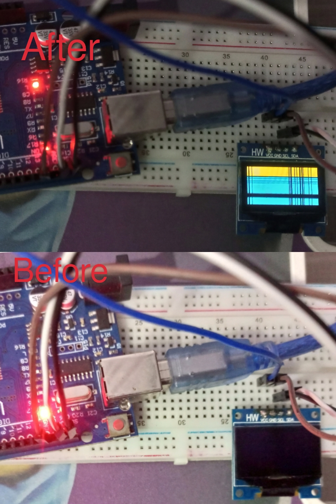

# ATmega328p — I2C (TWI) Bare-Metal Driver + SSD1306 OLED Bring-Up

Register-level I2C/TWI master implementation on the ATmega328p, tested end-to-end by driving a real SSD1306 I2C OLED display — no Wire.h, no Arduino library abstractions. Built on top of the earlier bare-metal UART project (used here for live debug output during bring-up).

## Things I learned

1. **7-bit addressing** — I2C supports up to 128 devices per bus via 7-bit addresses. The address byte actually put on the wire is the 7-bit address shifted left by 1, with the R/W bit in bit 0 (`(addr << 1) | rw`).
2. **Start/stop conditions** — a start condition is SDA transitioning high→low while SCL is high; a stop condition is SDA transitioning low→high while SCL is high. Both are signaled *while the clock line is held high*, which is what distinguishes them from a normal data bit change (which only happens while SCL is low).
3. **Packet structure** — every byte on the bus (address or data) is followed by a 9th bit: ACK (slave pulls SDA low) or NACK (SDA stays high). MSB is transmitted first.
4. **General call address (`0x00`)** — reserved as a broadcast address recognized by all slaves, not used in this project but part of the addressing scheme.
5. **Repeated start** — for transactions that need to change direction (e.g., write a register address, then read data back) without releasing the bus, a repeated start replaces what would otherwise be a stop-then-start. Not needed for this project (OLED is write-only here), but relevant for future sensor work (e.g., BMP280) where a register-select-then-read pattern is standard.
6. **Master role is not a configured mode** — unlike UART, there's no persistent "master mode" bit to set at init. The AVR TWI peripheral becomes master dynamically the moment a start condition is issued, and releases back to idle on stop. `twi_init()` only needs to configure the bus clock (TWBR + prescaler bits in TWSR).
7. **`TWCR` vs `TWSR` — control vs status, don't confuse them.** `TWCR` is where you set operation bits (`TWSTA`, `TWSTO`, `TWINT`, `TWEN`) to trigger start/stop/data transfer. `TWSR` is where you *read* status codes (upper 5 bits, masked with `0xF8`) after each operation to confirm what actually happened on the bus. Mixing these up was my first real bug — writing control bits into TWSR does nothing useful, since the hardware only acts on bits in TWCR.
8. **Status codes are the actual protocol feedback loop.** After every `twi_start()` and `twi_write()`, checking `TWSR & 0xF8` against the datasheet's defined codes (`START` = 0x08, `MT_SLA_W_ACK` = 0x18, `MT_DATA_ACK` = 0x28, etc.) is how you know whether the bus operation actually succeeded — there's no other way to know if a slave ACKed.

## What it does

- `twi_init()` — configures TWI bus clock (SCL ~100kHz via TWBR + prescaler)
- `twi_start()` / `twi_stop()` — issue start/stop conditions
- `twi_write(byte)` — writes a single byte (address or data) and checks the resulting status code
- `oled_send_command(cmd)` — wraps the above into a full transaction: start → address+write → control byte (0x00 = command) → command byte → stop
- `oled_init()` — sends the standard SSD1306 initialization command sequence (charge pump, addressing mode, contrast, display on, etc.)
- `oled_fill_screen()` — sets full column/page address range and writes `0xFF` across the entire framebuffer, lighting every pixel — used as an end-to-end proof-of-life test

## Result

- Full display successfully lit end-to-end — confirms correct TWI register usage, correct SSD1306 command sequence, and correct addressing, without any I2C or display library.

  

## Hardware

- ATmega328p (Arduino Uno board, used as bare hardware — no Arduino core/libraries)
- SSD1306 I2C OLED module (address `0x3C`)
- USB-serial adapter for UART debug output during bring-up