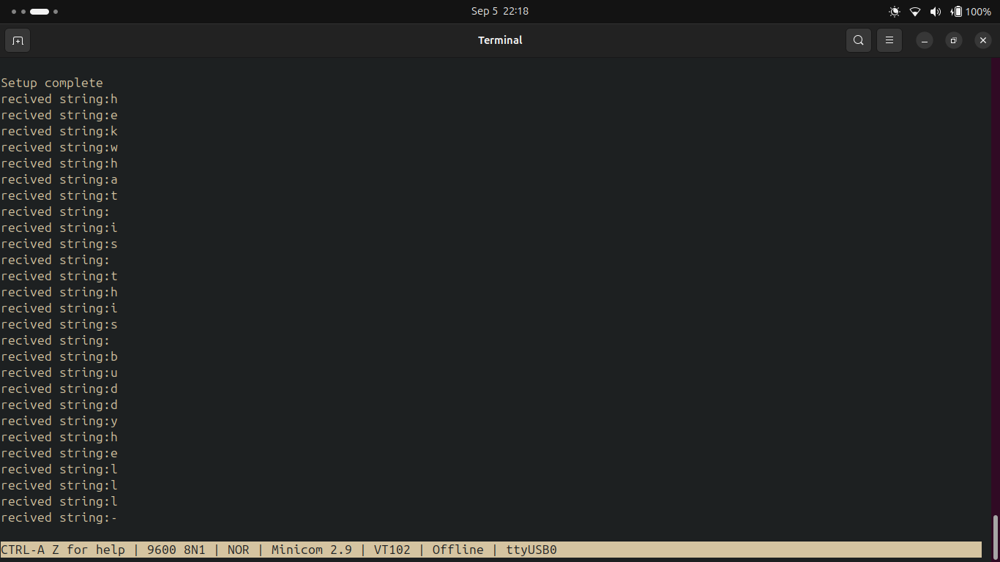

# Atmega328p mmcu chip
- In this repo i ll be writing the bare metal uart/i2c  driver code for the atmega328p, which lets the user write the string, and recives the text or logs printed by the chip back to the user serial terminal while also demonstrating the i2c communication with the module.  

## Things i learned : 
1. DDRx register : This is the data direction register, based on its value you configure your gpio pin, as the input or output. 
2. PORTx register : When the pin is configured as output , writing one to one of its bits , make the output logical one for that gpio pin. 
3. PINx register : When the pin is congiured as input, we can read the external inputs on the gpio pin. 

## Steps to configure the uart: 
1. The UMSELn bit in USART control and status register C (UCSRnC) selects between asynchronous and synchronous operation.
2. If you are using the synchronus mode (UMSELn=1) then you have to specify that you will be using the master synchronus(internal clock) or slave synchronus(external clock), the data direction register for the XCKn pin (DDR_XCKn) controls whether the clock source is internal (master mode) or external (slave mode).

3. The usart baud rate register (UBRR) is used for generating the clock of differnt baud rate, when down counter running at the sys clock(f_cpu) reaches 0 its reloaded with the value of the ubrr register value.

    Formula for calucating the value of ubrr register value : 
    $$ UBRR0= \frac{F_{CPU}}{16\times Baud}−1 $$

    For the Uno:

    $$ F_{CPU}=16\,MHz,\quad Baud=9600 $$

    So:

    $$ UBRR0 = \frac{16,000,000}{16\times9600}-1 $$ $$ =104.1667-1 $$
    UBRR0≈103
	​
4.  The frame format used by the USART is set by the UCSZn2:0, UPMn1:0 and USBSn bits in UCSRnB and UCSRnC. Thereceiver and transmitter use the same setting. Note that changing the setting of any of these bits will corrupt all ongoing communication for both the receiver and transmitter.
    - The USART character size (UCSZn2:0) bits select the number of data bits in the frame. The USART parity mode (UPMn1:0) bits enable and set the type of parity bit. The selection between one or two stop bits is done by the USART stop bit select (USBSn) bit. The receiver ignores the second stop bit. An FE (frame error) will therefore only be detected in the cases where the first stop bit is zero.
5. Then enabling the reciver and transmitter by setting the corresponding bits in the UCSRB register. 

## Output

